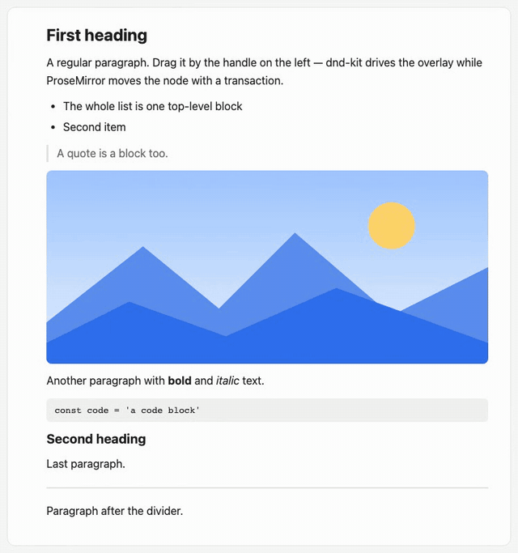

<h1 align="center">tiptap-dnd-kit</h1>

<p align="center">
  Headless drag-and-drop for <a href="https://tiptap.dev">Tiptap</a>, powered by <a href="https://dndkit.com">dnd-kit</a>.<br />
  Bring your own handle and preview — the library does the rest without ever touching the editor DOM.
</p>

<p align="center">
  <a href="https://gaurussel.github.io/tiptap-dnd-kit/"><b>Live demo</b></a> ·
  <a href="https://www.npmjs.com/package/tiptap-dnd-kit">npm</a>
</p>

<p align="center">
  <a href="https://gaurussel.github.io/tiptap-dnd-kit/">
    
  </a>
</p>

## Features

- **Every drag goes through dnd-kit** — ProseMirror's native HTML5 drag-and-drop is replaced for blocks, selected
  text, selected nodes, images and other atoms.
- **Any handle** — bind any element as the drag handle of the hovered block; mouse and keyboard
  (<kbd>Space</kbd>, arrows, <kbd>Enter</kbd>/<kbd>Esc</kbd>) both work.
- **Polished feedback** — neighbouring blocks make room, text opens a gap at the drop point, and the preview flies
  into place on drop.
- **Editing-aware moves** — smart spacing around moved words, drops into lists and quotes, one undo step per move.
- **Safe by design** — dnd-kit never mutates DOM inside the editor; everything shown there is a ProseMirror
  decoration, so collaboration and remote edits mid-drag keep working.
- **Headless** — no components and no stylesheet: hooks for React, a small controller API for everything else.

## Install

```bash
npm i tiptap-dnd-kit @dnd-kit/dom
```

Peer dependencies: `@tiptap/core` and `@tiptap/pm` 3.x, `@dnd-kit/dom` 0.5.x, and `react` 18/19 for the React hooks.

## Quick start

```ts
import { Editor } from '@tiptap/core'
import StarterKit from '@tiptap/starter-kit'
import { DndKit } from 'tiptap-dnd-kit'

const editor = new Editor({
    extensions: [StarterKit, DndKit],
})

editor.commands.disableDnd() // enableDnd / toggleDnd; a read-only editor disables dnd automatically
```

### React

The handle and the preview are your components; the hooks connect them to the editor.

```tsx
import { createPortal } from 'react-dom'
import { useDragHandle, useDragPreview } from 'tiptap-dnd-kit/react'

function Handle({ editor }) {
    const { ref, block, isDragging } = useDragHandle(editor) // block.dom is the hovered block
    return <button ref={ref} style={positionNextTo(block)}>⋮⋮</button>
}

function Preview({ editor }) {
    const target = useDragPreview(editor) // { source, container } while dragging
    return target ? createPortal(<MyCard kind={target.source.kind} />, target.container) : null
}
```

### Without React

```ts
const controller = editor.storage.dndKit.controller
const unbind = controller.bindHandle(myHandleElement)
controller.subscribe(({ hoveredBlock, phase }) => moveHandleTo(hoveredBlock?.dom))
```

## Styling

The package ships no CSS — it only sets the inline styles behaviour depends on. Style these hooks your way:

| Class / attribute | What it is |
|---|---|
| `.dnd-kit-source`, `.dnd-kit-source-inline` | the dragged block / text |
| `.dnd-kit-landing`, `.dnd-kit-landing-inline` | inserted content while the preview flies to it |
| `.dnd-kit-inline-gap` | the gap opened in text at the drop point |
| `.dnd-kit-drop-line` | the block drop line (a fixed element outside the editor) |
| `.dnd-kit-preview` | the preview container that follows the pointer |
| `[data-dnd-kit-drag]` | set on the editor while dragging (`block`, `node`, `blocks` or `text`) |

```css
.dnd-kit-source, .dnd-kit-source-inline { opacity: 0.25; }
.dnd-kit-inline-gap::before { content: ''; position: absolute; inset: -0.15em auto -0.25em 0; width: 2px; background: #2f6fed; }
.dnd-kit-drop-line { height: 2px; background: #2f6fed; }
.dnd-kit-preview { background: #fff; border-radius: 6px; box-shadow: 0 6px 24px rgb(0 0 0 / 0.14); }
```

## Options

| Option | Default | Purpose |
|---|---|---|
| `enabled` | `true` | Initial state |
| `manager` | `null` | Share your app's `DragDropManager` |
| `features` | all `true` | `selectionDrag`, `atomDrag`, `nestedDrop`, `smartSpacing`, `animations` |
| `classes` | `dnd-kit-*` | Rename the styling hooks |
| `renderPreview` / `renderDropLine` | `null` | Custom DOM for the preview and the drop line |
| `dropAnimation` | `220ms` | Duration and easing of the drop flight |
| `hoverArea` | the editor's parent | Where block hover is tracked; also the drop zone, so it must contain your handle |
| `canDrag` / `canDrop` | `null` | Forbid a drag or a specific drop point |
| `onDragStart` / `onDrop` / `onDragEnd` | `null` | `onDrop` may return its own transaction or `false` to cancel |

See [packages/tiptap-dnd-kit](packages/tiptap-dnd-kit/README.md) for limitations and details.

## Development

```bash
npm install
npm run dev     # demo at http://localhost:5175
npm test        # unit tests (Vitest)
npm run e2e     # end-to-end tests in Chromium (Playwright)
npm run build   # build the package
npm run lint    # Biome
```

Every push to `master` runs lint, unit and e2e tests, builds the package and deploys the demo to GitHub Pages.
Bump `version` in [`packages/tiptap-dnd-kit/package.json`](packages/tiptap-dnd-kit/package.json) to publish it to npm
and create a GitHub release; an unchanged version skips publishing.

| Path | Contents |
|---|---|
| [`packages/tiptap-dnd-kit`](packages/tiptap-dnd-kit) | the library: core extension and controller, React hooks |
| [`examples/react`](examples/react) | the demo app, built only on the public API, plus the e2e suite |

## License

[MIT](LICENSE)
